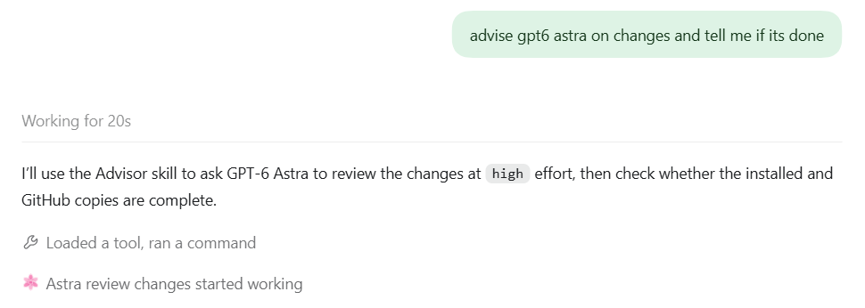

# Advisor for Codex

Advisor is a Codex skill that asks an advisor subagent for a second opinion.
The main agent evaluates the advice and owns the final decision.

Use the skill for one decision, a milestone, or advice throughout a task.

## Example

This example shows an advisor consultation in progress.



## Requirements

- Codex with a subagent tool.
- Access to the model and reasoning effort that you request.

The available models and reasoning efforts depend on the active subagent tool.

## Install

Clone this repository:

```sh
git clone https://github.com/Broklam/codex-advisor-skill.git
cd codex-advisor-skill
```

Check your configured skill locations for an existing `advisor` skill.
For example, check `~/.agents/skills/advisor` and `~/.codex/skills/advisor`.
If a copy exists, back it up before you update it.
Replace its `SKILL.md` and `agents/openai.yaml` with the files from `advisor/`.
Use one location for the skill.

For a new installation, check that `~/.agents/skills/advisor` does not already exist.
Run the commands for your system below.

On macOS or Linux, run:

```sh
mkdir -p ~/.agents/skills
cp -R advisor ~/.agents/skills/
```

On Windows, run:

```powershell
New-Item -ItemType Directory -Force -Path "$HOME\.agents\skills" | Out-Null
Copy-Item -Recurse -LiteralPath .\advisor -Destination "$HOME\.agents\skills\advisor"
```

Codex detects the skill automatically.
If the skill does not appear, restart Codex.
See the [Codex skills documentation](https://learn.chatgpt.com/docs/build-skills) for other installation locations.

## Use

Ask Codex to use `$advisor` for a specific topic.
You can also name a model and a reasoning effort.
The model and reasoning effort must be available in the active subagent tool.

For one decision:

```text
Use $advisor to consult gpt-6.1-terra at xhigh effort on this design.
```

For advice throughout a task:

```text
Use $advisor with gpt-6-astra at high effort at milestones and difficult blockers.
```

If you omit an effort, the skill uses the effort from a matching advisor assignment.
Otherwise, it uses `high`.
If `high` is unavailable, the skill asks you to choose a supported effort.
If you do not specify a model, the skill uses an existing advisor assignment or inherits the main agent's model.

## How it works

1. Codex identifies the parameters of your request.
2. Codex starts an advisor subagent with the relevant context.
3. The advisor reviews the evidence and returns a recommendation.
4. The main agent evaluates the advice and reports the result.

The advisor provides advice only and does not edit files or delegate work.
If the requested model or effort is unavailable, the skill asks for a supported choice.

## Files

- [`advisor/SKILL.md`](advisor/SKILL.md) contains the skill instructions.
- [`advisor/agents/openai.yaml`](advisor/agents/openai.yaml) contains the display metadata and default prompt.
